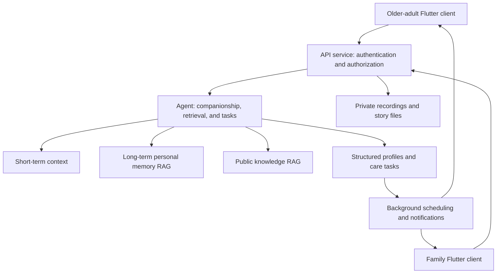

# Anxin Companion: Implementation Plan for an Elderly Companionship and Care Agent

## 1. Product and Delivery Goals

Build an agent that supports text and Cantonese input, maintains long-term memory, retrieves information, and carries out care-related tasks. It will address emotional companionship, loneliness, family communication, and anxiety about healthcare and family care costs among older adults.

The first version includes seven capabilities:

| Capability | Implementation |
|---|---|
| Emotional companionship | Understand and respond to loneliness, guilt, and financial worries; maintain conversational continuity; offer practical help when wanted. |
| Life memories | Journals, stories, saved recordings, retrieval of past memories, and shareable story cards. |
| Family communication | Two-way messages, expressing care needs, invitations to accompany the older adult, and follow-up on replies. |
| Welfare support | Retrieval of official Hong Kong information, checks against eligibility requirements, application checklists, and progress tracking. |
| Scheduling assistance | Medical follow-ups, activities, everyday reminders, conflict notices, and completion follow-up. |
| Community connections | Find elderly centres and verified activities based on district, interests, and mobility preferences. |
| Proactive check-ins | Agreed greetings, task follow-up, and assistance contacting a person when needed. |

A single conversation may involve emotions, memories, and tasks simultaneously. The agent first understands what the user needs, then decides whether to use tools, rather than automatically turning an emotional disclosure into a to-do item.

The first version excludes direct hospital booking submissions, welfare application submissions on the user's behalf, automated phone calls, continuous listening, acoustic diagnosis, and smart-plug integration. Appointment coordination initially consists of family collaboration, reminders, and links to official booking channels.

Delivery milestones are **October 4, 2026: interim report; October 18, 2026: pitch deck and prototype submission; October 24, 2026: final presentation**. [Official deliverable requirements](https://www.hack4sdg.com/deliverables/)

## 2. Three-Part Architecture and Technical Implementation

The system consists of an **older-adult client, a family/caregiver client, and a server backend**. Both user-facing clients are delivered through one Flutter application, with separate accounts and explicit authorization relationships. The backend is deployed independently.

| Component | Features and Responsibilities |
|---|---|
| Older-adult client | Text and voice conversations, today's schedule, stories and memories, family messages, sharing permissions, and check-in preferences. |
| Family/caregiver client | Authorized family updates, message replies, care tasks, welfare assistance, and notification handling. |
| Server backend | Identity and authorization, agent execution, memory and RAG, data synchronization, tool execution, background scheduling, notifications, and audit records. |

All shared data is synchronized through the backend. Family members can access only explicitly authorized content; switching roles must not expose the older adult's private conversations. The backend continues processing configured reminders and follow-ups after the application is closed.

Technical choices:

| Layer | Approach |
|---|---|
| Client | Flutter and Riverpod; Android is the initial acceptance-testing platform. |
| Backend | Python and FastAPI. |
| Agent orchestration | LangGraph, supporting persisted state, confirmation pauses, and resumption. |
| Data storage | PostgreSQL and pgvector. |
| Audio files | Private object storage accessed through short-lived authorized links. |
| Background execution | Separate worker process and a database-backed task queue. |
| Model integration | A shared server-side adapter; conversational models and embedding services selected through configuration. |
| Cantonese input | Tencent Cloud ASR; users can edit the transcript before sending. |
| Notifications | In-app inbox, Android push notifications, and local scheduled reminders. |
| Deployment | Containerized deployment on a Hong Kong-region server, with demonstration and trial data separated. |

Create a new project and selectively migrate Zendiary's task models, recurring reminders, action previews, and related tests. Keep the original project independent and do not import its existing personal data.

Text and voice share the same conversations, memory, and tools. Implement the complete text workflow first, then add recorded-audio transcription, followed by Cantonese read-aloud functionality. Model-provider credentials remain on the server.

## 3. Agent, Long-Term Memory, and RAG

The shared processing flow is:

> Validate identity and permissions → check for immediate safety concerns → load context and relevant memories → understand the user's needs → respond or call tools → obtain confirmation where necessary → execute and record the result.

Internal tools cover memory management, story organization, welfare retrieval, community searches, reminders, family messages, task follow-up, and human assistance. Ordinary companionship does not require a tool call. Tool execution has limits on iterations and timeouts.

Long-term memory explicitly uses **RAG plus structured data**:

| Data Layer | Stored Content | Access Method |
|---|---|---|
| Short-term conversation context | Recent messages, rolling summaries, current topics, and outstanding questions. | Loaded with the conversation. |
| **Long-term personal memory RAG** | Life stories, past conversations, important experiences, and dated personal expressions. | Retrieved according to the current topic. |
| Structured profiles and tasks | Family relationships, preferences, permissions, appointment times, and task status. | Exact queries. |
| **Public knowledge RAG** | Hong Kong welfare schemes, healthcare cost assistance, care services, and community resources. | Retrieval with source attribution. |

The two RAG systems use separate tables and retrieval entry points while sharing database infrastructure. Private memories never enter the public knowledge collection.

### Personal Memory Lifecycle

- After a conversation, extract candidate memories and distinguish facts, experiences, temporary emotions, and information requiring confirmation.
- Store the original source, owner, event time, confirmation status, sharing scope, and correction relationships, then create vector indexes.
- Clear, non-sensitive information may be organized automatically. Sensitive or ambiguous information requires confirmation. Model inferences are not stored directly as facts.
- Apply permission filters before retrieval. Combine keyword and vector matching, excluding deleted or superseded content.
- Supply retrieved memories together with recent context. When evidence is missing, ask the user rather than inventing shared experiences.
- Users can correct, delete, or ask the agent not to bring up a memory. Deletion propagates to source records, indexes, summaries, and derived content under the system's control.

“I feel sad today” must not become a permanent personality label. After an address update, the previous address must not be treated as current. Permissions, appointment times, and task status are read from structured records every time, rather than relying on retrieval to find them.

The first version uses a lightweight custom memory service and pgvector, without deploying an additional standalone memory framework.

### Public Knowledge Retrieval

Initial coverage includes medical fee waivers, community care services, caregiver support, and a basic directory of elderly centres across Hong Kong's 18 districts.

Official material is extracted, manually checked, and divided into passages that preserve complete eligibility conditions before indexing. Each item retains its source, effective date, and verification date. Only verified activity listings are displayed.

Results contain the reason a resource may be relevant, conditions still requiring verification, three next steps, an official link, and the verification date. Ask follow-up questions when information is incomplete; do not promise approval.

Applications become persistent tasks with statuses such as awaiting documents, enquiry completed, submitted, and completed. External documents provide information only; they cannot instruct the agent to invoke tools.

## 4. Collaboration, Proactive Check-Ins, and Interfaces

### Action Execution

Separate the agent's proposed actions from backend execution. Before sending a message, sharing a recording, or inviting family collaboration, display the content and recipients. After confirmation, recheck permissions and execute idempotently.

The agent reports completion only after receiving a successful execution result. Network retries must not duplicate messages or tasks. Failed operations retain a resumable state.

Adapt Zendiary's intent parser into a task tool. Do not use rules such as “a clock time means an event” as the main conversation classifier. Times mentioned in memories must not automatically create reminders.

### Proactive Check-Ins

Users opt in and choose the frequency. The suggested default is once per day, with adjustable quiet hours of 21:00–09:00. Avoid repeating a check-in if the relevant conversation has already taken place that day.

Proactive triggers are limited to agreed greetings, due reminders, consented follow-ups, and family replies. Users can pause one occurrence, one topic, or all proactive check-ins.

### Safety Assistance

Expressions of immediate danger trigger supportive communication and a human-help workflow without abruptly ending the conversation. Contact designated people according to previously configured emergency authorization; do not broadcast to all family members by default.

An ordinary missed response is not automatically classified as a crisis. Track notifications as pending, sent, acknowledged, handled, or failed. The first version does not claim to provide round-the-clock rescue or social-worker dispatch.

### Data and Interfaces

Core entities include accounts, family authorizations, conversations, messages, personal memories, stories, recordings, tasks, reminders, knowledge sources, pending actions, notifications, and audit records.

| Interface Group | Responsibility |
|---|---|
| `/auth`, `/family-links` | Login, invitation-based linking, and authorization revocation. |
| `/conversations` | Messages, streaming responses, sources, and action cards. |
| `/audio/transcriptions` | Audio transcription. |
| `/memories`, `/stories` | Retrieval, correction, deletion, and sharing drafts. |
| `/tasks`, `/reminders` | Creation, modification, completion, and pausing. |
| `/actions/{id}/confirm` | Permission revalidation and idempotent execution. |
| `/resources/search` | Resource retrieval with sources. |
| `/notifications`, `/preferences` | Notification status, check-in preferences, and sharing settings. |

Offline input remains in a client-side outgoing queue and is clearly marked as unsynchronized. Original audio is deleted after successful transcription by default; retain it long term only when the user chooses to save a story or voice message.

## 5. Implementation Sequence and Acceptance Criteria

| Stage | Dates in 2026 | Deliverables |
|---|---|---|
| Foundation | September 20–27 | Three-part architecture, accounts and authorization, text chat, short-term context, and task confirmation. |
| Interim version | September 28–October 4 | Long-term personal memory RAG, public knowledge RAG, stories, family messages, and interim report. |
| Full-capability version | October 5–11 | Cantonese input, community resources, proactive follow-up, and safety assistance. |
| Submission version | October 12–17 | Physical-device testing, feedback-driven fixes, demonstration video, and pitch deck. |
| Formal submission | October 18 | Prototype and submission materials. |

Prepare at least 60 fixed acceptance scenarios covering the following:

- Emotions and tasks in the same message are both handled appropriately.
- Relevant stories can be recalled across conversations, with no invented memories when evidence is absent.
- Corrected or deleted memories do not reappear incorrectly.
- Family members cannot access unauthorized data through chat, search, or file links.
- Welfare answers have supporting evidence, missing conditions prompt follow-up questions, and conflicting sources are clearly identified.
- Cantonese transcription errors can be corrected before an action is executed.
- Retries do not duplicate execution; offline and service-failure states are clearly displayed.
- Quiet hours, paused check-ins, and authorization revocation take effect immediately.
- Dangerous statements enter the assistance workflow, while ordinary missed responses are not automatically treated as crises.

Before release, permission isolation, memory correction and deletion, and duplicate-execution tests must all pass. Complete an end-to-end acceptance test using separate devices for the older adult and family member.

Monitor response latency, retrieval quality, tool failures, task completion, and notification acknowledgement. Operational logs do not contain full private conversations or recordings by default. Provide switches to disable proactive messages and external actions.

The delivery baseline is Android, a Traditional Chinese interface, text-first interaction, and Cantonese input. Initial trial users must be able to communicate and authorize sharing independently. Competition demonstrations use clearly labelled fictional families; actual value is evaluated through consented user feedback.
